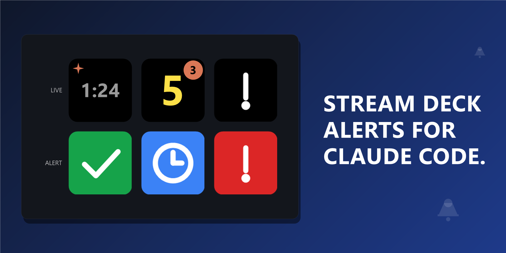

# Agentic Hooks — Stream Deck plugin

Flash a Stream Deck button on Claude Code hook events (turn end, permission request, task completed). Runs on Windows and macOS; remote Claude sessions work over SSH from any POSIX host.



> Please report issues at [github.com/nshopik/agentichooks/issues](https://github.com/nshopik/agentichooks/issues). The plugin is distributed via GitHub Releases.

> **Requires Claude Code 2.1.145+.** Hooks are wired as native [`type: "http"`](https://code.claude.com/docs/en/hooks.md) entries. Per the [Claude Code changelog](https://github.com/anthropics/claude-code/blob/main/CHANGELOG.md), HTTP hooks arrived in 2.1.63, and 2.1.84 added the `TaskCreated` event (drives the in-flight task count) and `type: "http"` support for `WorktreeCreate`. Older versions silently ignore the entries they don't support. Upgrade Claude Code if button responses look incomplete after running the installer.
>
> Since 2.1.145, `Stop` hook bodies carry `background_tasks`. The On Stop button skips its alert (sound and flash) while subagents, workflows, teammates, cloud sessions or MCP tasks are still running. Shell and monitor background tasks don't suppress it. On older Claude Code the field is absent and every `Stop` alerts immediately.

> **macOS support is experimental.** The Windows install path is the tested one; macOS code paths exist (afplay, system sounds, hook installer) but have not yet been validated end-to-end on a real Mac. Bug reports from Mac users are very welcome.

## Features

- Auto-clear when you reply: a `UserPromptSubmit` hook dismisses any active alert when you submit your next prompt.
- Static or pulsing flash mode, configurable per button.
- Live subagent count: the Task Completed button shows how many subagents are running as a big coral number. With **Show task count** on, the big number is the in-progress task count instead — a rough progress bar for the run — and a small coral pill in the corner shows the subagent count. The button flashes once when a session's last task completes, with no per-task noise. Claude Code creates tasks by default only on Opus 4.7, Sonnet 4.6, Haiku 4.5, and earlier models; on newer models set [`CLAUDE_CODE_ENABLE_TODO_TOOLS=1`](https://code.claude.com/docs/en/tools-reference#task-tool-availability).
- On Stop thinking indicator: from when you submit a prompt until Claude stops, the On Stop button shows a gray elapsed-time timer and an animated coral sparkle. Unchecking **Animate thinking sparkle** in the button's Property Inspector hides only the sparkle; the timer stays.
- Optional audio cue per event. Stop and Permission default to system sounds (`Speech On.wav` / `Windows Message Nudge.wav` on Windows; `Glass.aiff` / `Funk.aiff` on macOS). Task Completed has no default sound — silent unless you pick a file.
- Works for remote Claude sessions via SSH reverse tunnel — your local deck flashes when Claude finishes on a remote machine.

## Install from Release

1. Go to [github.com/nshopik/agentichooks/releases/latest](https://github.com/nshopik/agentichooks/releases/latest).
2. Download `com.nshopik.agentichooks.streamDeckPlugin`.
3. Double-click the file. Stream Deck imports it.
4. Add one (or more) of the **On Stop**, **On Permission**, or **On Task Completed** actions from the "Agentic Hooks" category to keys. Configure (optional) audio in the Property Inspector.
5. (Migration only — skip unless you previously installed from the `claudenotify` repo): remove any `~/.claude/settings.json` hook entries that contain `"_claude-notify-installer": "v7"`, to avoid duplicate hook firings.
6. Download the hook installer for your platform from the same release page and run it:
   - Windows: download `install-hooks.ps1` then run `powershell -ExecutionPolicy Bypass -File .\install-hooks.ps1`
   - macOS / Linux: download `install-hooks.sh` then run `bash install-hooks.sh` (requires `jq`)

## Build from Source

```
git clone https://github.com/nshopik/agentichooks
cd agentichooks
npm install
npm run build
npx streamdeck link com.nshopik.agentichooks.sdPlugin
```

After linking, run the hook installer (Quick Start section below) to wire up Claude Code hooks for your local environment.

## Quick Start

**Local on Windows.** Run the installer to add the 29 Claude hook entries to `~/.claude/settings.json`:

```powershell
powershell -ExecutionPolicy Bypass -File .\install-hooks.ps1
```

**Local on macOS.** Run the POSIX installer (also used for remote hosts; it points at `127.0.0.1:9123` by default and requires `jq`):

```bash
bash install-hooks.sh
```

Both installers are idempotent — safe to run multiple times.

**Remote (Linux/macOS).** Add a reverse-forward to `~/.ssh/config` on the machine running the Stream Deck plugin:

```
Host my-dev-vm
  HostName dev-vm.example.com
  User you
  RemoteForward 9123 127.0.0.1:9123
```

SSH in and verify the tunnel:

```bash
curl -i http://localhost:9123/health
```

Expected: `HTTP/1.1 200 OK`. Then run `bash install-hooks.sh` on the remote host — it writes the 29 native `type: "http"` hook entries that POST to `http://127.0.0.1:9123/event/<route>` (forwarded back to the Windows host by `ssh -R`). The listener binds `127.0.0.1` and rejects any request whose `Host` is not `127.0.0.1:9123` or `localhost:9123`, so the remote end of the tunnel must also be port 9123.

## HTTP routes

The listener accepts 29 routes (14 action + 15 info). URL paths mirror Claude hook names: `/event/post-tool-use` ↔ `PostToolUse`, `/event/user-prompt-submit` ↔ `UserPromptSubmit`, etc.

| Route | Effect |
|---|---|
| `/event/stop` | arms `stop`, or clears it when `background_tasks` lists agentic tasks; clears `permission`, `task-completed`; clears thinking; resets the session's subagent count when `background_tasks` lists none |
| `/event/stop-failure` | arms `stop`; clears `permission`, `task-completed`; clears thinking |
| `/event/permission-request` | arms `permission` |
| `/event/task-completed` | decrements in-flight task count (id-set; `task_id` required); clears `permission` (main thread only); arms `task-completed` when the session's last task completes |
| `/event/task-created` | adds to in-flight task count (id-set; `task_id` required); clears `task-completed` |
| `/event/subagent-start` | increments running subagent count (id-set; `agent_id` required); clears `stop` |
| `/event/subagent-stop` | decrements running subagent count (id-set; `agent_id` required); no alert state change |
| `/event/session-start` | clears `stop`, `permission`, `task-completed`; resets task, subagent, and thinking counters; no-op for `source` `compact` or `resume` |
| `/event/session-end` | clears `stop`, `permission`, `task-completed`; resets task, subagent, and thinking counters |
| `/event/user-prompt-submit` | clears `stop`, `permission`, `task-completed`; marks session as thinking |
| `/event/permission-denied` | clears `permission` |
| `/event/post-tool-use` | clears `permission` |
| `/event/post-tool-use-failure` | clears `permission` |
| `/event/pre-tool-use` | clears `stop` |
| `/event/notification` | log-only |
| `/event/post-tool-batch` | log-only |

`GET /health` returns `200 OK`.

## Configuration

Per-button settings are exposed in the Property Inspector and self-describing.

Each button's Property Inspector also shows that event's plugin-wide settings, shared by every button of the same type:

- **Audio per event** — sound file. Stop and Permission default to system sounds; Task Completed has no default. **Mute** clears the path; **Reset to default** restores the system sound.
- **Alert delay per event** — seconds between an arming hook and the alert firing. Default `0 s` for Stop (labelled **Tolerance delay**), `1 s` for Permission and Task Completed. `0` fires immediately.
- **▶ Test** — plays the configured sound.
- **Show task count** (Task Completed) — on: task count + subagent pill; off: subagent count only. Default off.

## Alert delay window and clear matrix

An arming hook enters a "pending" state for the configured delay; any clearing hook arriving inside that window cancels the pending alert with no sound and no flash. Repeat arms of the same event type during the pending window are no-ops — the original timer keeps running, never extended. This guards against fast `PermissionRequest → PostToolUse` races where a tool resolves in well under a second.

| Armed event | Cleared by | Auto-timeout default |
|---|---|---|
| `stop` | `Stop` (re-arm; clears instead when `background_tasks` lists agentic tasks), `StopFailure` (re-arm), `PreToolUse`, `SubagentStart`, `UserPromptSubmit`, `SessionStart`, `SessionEnd`, manual press | 0 (no timeout) |
| `permission` | `Stop`, `StopFailure`, `TaskCompleted` (main thread), `PermissionRequest` (re-arm), `UserPromptSubmit`, `SessionStart`, `SessionEnd`, `PermissionDenied`, `PostToolUse`, `PostToolUseFailure`, manual press | 0 (no timeout) |
| `task-completed` | `Stop`, `StopFailure`, `TaskCreated`, `TaskCompleted` (re-arm), `UserPromptSubmit`, `SessionStart`, `SessionEnd`, manual press, auto-timeout | 30,000 ms |

`SessionStart` with `source` `compact` or `resume` clears nothing. `Stop` (or `StopFailure`) ends a turn, so it dismisses both `permission` and `task-completed`. A main-thread `TaskCompleted` clears `permission` because tool resolution implies the permission was settled; a subagent's `TaskCompleted` only updates the task count. `PreToolUse` clears `stop` because the agentic loop has restarted without user input (auto-continue, `/continue`, compact-and-continue).

## Plugin-down behavior

When the Stream Deck plugin is running, the listener replies before it processes the event, so a hook returns in about a millisecond. When the plugin is stopped, Claude Code falls back on the per-hook `timeout: 2` (seconds) that the installer sets. On Windows, a connection to a closed `127.0.0.1` port takes about 2 s to fail instead of being refused at once, so each blocking hook costs ~2 s while the plugin is down. The cost goes away the moment the plugin is restarted; no settings.json changes are needed.

## Debug logging

The plugin defaults to `info` log level. Set `AGENTIC_HOOKS_DEBUG=1` to raise it to `debug`. The plugin inherits Stream Deck's environment, so on Windows set the variable at user level (a variable set only in a shell doesn't reach it), then restart Stream Deck.

Logs land in the plugin's `logs/` directory as `com.nshopik.agentichooks.0.log` (newest is `.0`):

- Windows: `%APPDATA%\Elgato\StreamDeck\Plugins\com.nshopik.agentichooks.sdPlugin\logs\`
- macOS: `~/Library/Application Support/com.elgato.StreamDeck/Plugins/com.nshopik.agentichooks.sdPlugin/logs/`

## Development

Standard npm scripts (`test`, `build`, `dev`, `typecheck`, `pack`); see `package.json`.

## License

MIT
